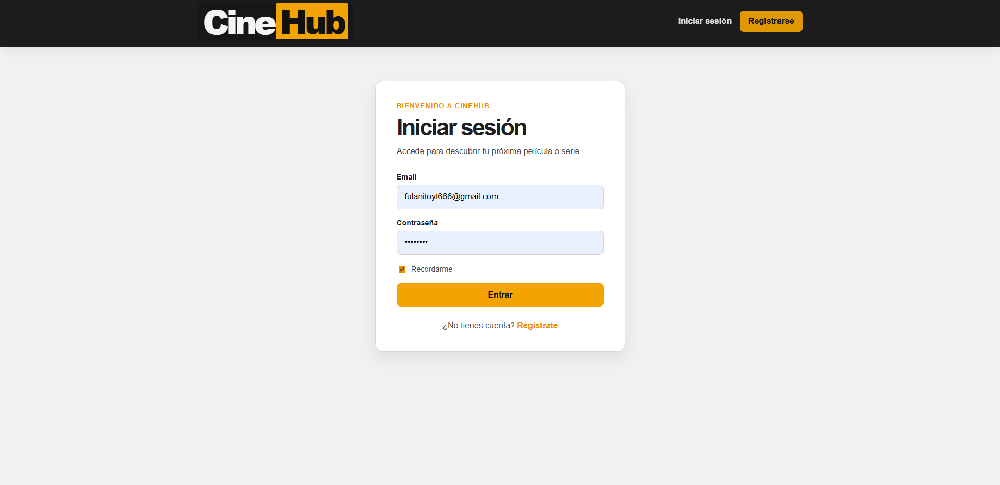
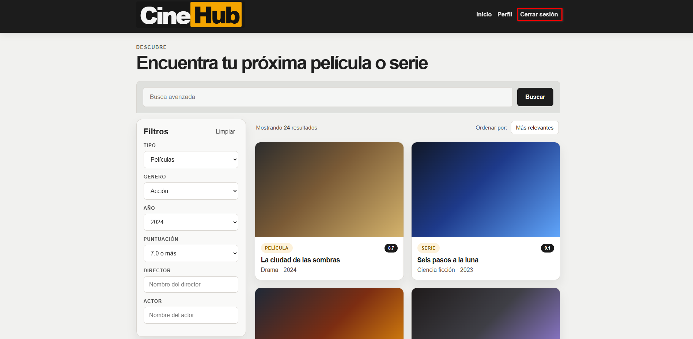

# Manual de usuario: autenticación y roles

## Registro

1. Acceder a `/register`.
2. Introducir nombre, email y contraseña.
3. Repetir la contraseña.
4. Pulsar **Registrarse**.

La cuenta se crea automáticamente con el rol `user`.

## Inicio de sesión

1. Acceder a `/login`.
2. Introducir email y contraseña.
3. Opcionalmente activar **Recordarme**.
4. Pulsar **Entrar**.

Después del login se muestra el dashboard.

## Cierre de sesión

Desde cualquier página autenticada, pulsar **Cerrar sesión**. La sesión se invalida y se vuelve a la pantalla de login.

## Gestión del perfil

1. Iniciar sesión.
2. Acceder a **Perfil**.
3. Modificar nombre o email.
4. Pulsar **Guardar cambios**.

El usuario no puede modificar su rol desde esta pantalla.

## Usuario normal

El usuario normal puede acceder al dashboard y a su perfil. Si intenta acceder a `/admin`, recibe un error `403`.

## Administrador

El administrador puede acceder a **Administración** o directamente a `/admin`.

Las funcionalidades del catálogo administrativo se incorporarán en las siguientes tareas.

## Usuarios de demostración

| Rol | Email | Contraseña |
|---|---|---|
| Administrador | `admin@cinehub.test` | `password` |
| Administrador root | `root@cinehub.test` | `root` |
| Usuario | `user@cinehub.test` | `password` |

Estas credenciales no deben utilizarse fuera del entorno local.

## Datos de demostración

Al ejecutar `php artisan migrate --seed` o `php artisan db:seed`, CineHub prepara datos para probar el catálogo:

- Películas y series publicadas.
- Un contenido en estado borrador para probar filtros.
- Géneros.
- Directores, creadores y actores.
- Valoraciones.
- Una reseña aprobada.
- Un comentario.
- Una lista de favoritos con contenidos.

Estos datos permiten comprobar la navegación del catálogo y las relaciones de la ficha antes de introducir contenido desde el panel de administración.
