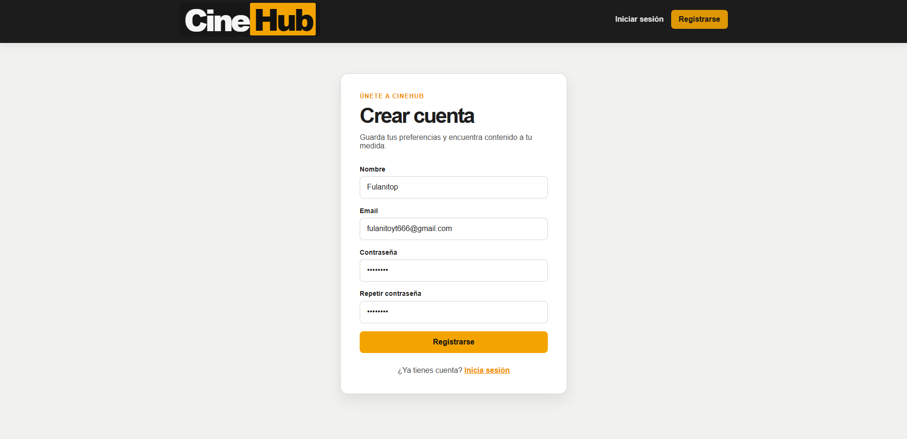
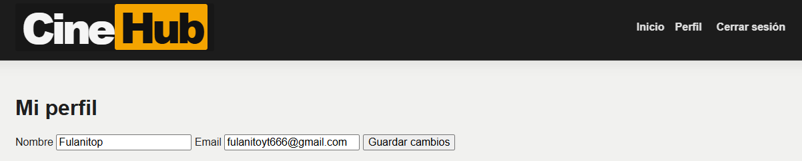
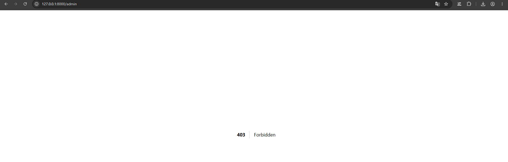
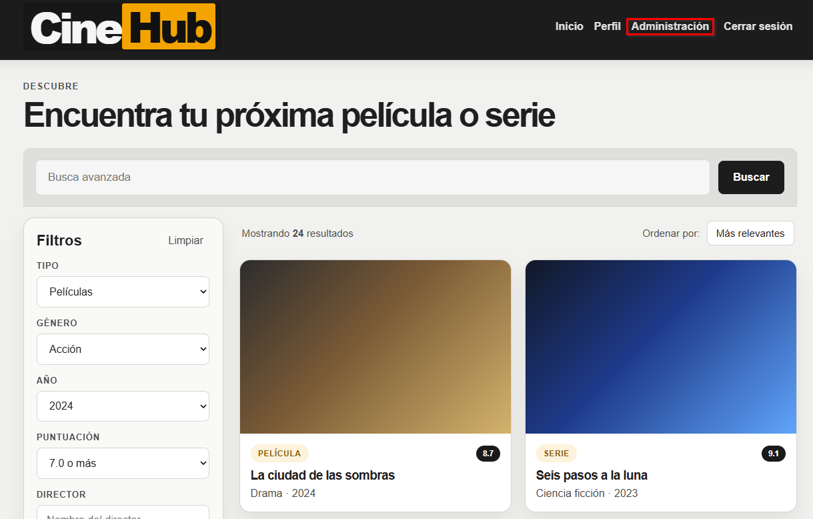

# Manual de usuario: autenticación y roles

## Registro

1. Acceder a `/register`.
2. Introducir nombre, email y contraseña.
3. Repetir la contraseña.
4. Pulsar **Registrarse**.

La cuenta se crea automáticamente con el rol `user`.

## Inicio de sesión

1. Acceder a `/login`.
2. Introducir email y contraseña.
3. Opcionalmente activar **Recordarme**.
4. Pulsar **Entrar**.

Después del login se muestra el dashboard.

## Cierre de sesión

Desde cualquier página autenticada, pulsar **Cerrar sesión**. La sesión se invalida y se vuelve a la pantalla de login.

## Gestión del perfil

1. Iniciar sesión.
2. Acceder a **Perfil**.
3. Modificar nombre o email.
4. Pulsar **Guardar cambios**.

El usuario no puede modificar su rol desde esta pantalla.

## Usuario normal

El usuario normal puede acceder al dashboard y a su perfil. Si intenta acceder a `/admin`, recibe un error `403`.

## Administrador

El administrador puede acceder a **Administración** o directamente a `/admin`.

Las funcionalidades del catálogo administrativo se incorporarán en las siguientes tareas.

Las cuentas disponibles se crean mediante el registro o por un administrador. No existen usuarios de demostración preconfigurados.

Al ejecutar `php artisan migrate --seed` o `php artisan db:seed`, CineHub importa el catálogo desde TMDB cuando está configurado. No se crean datos artificiales ni cuentas de demostración.
